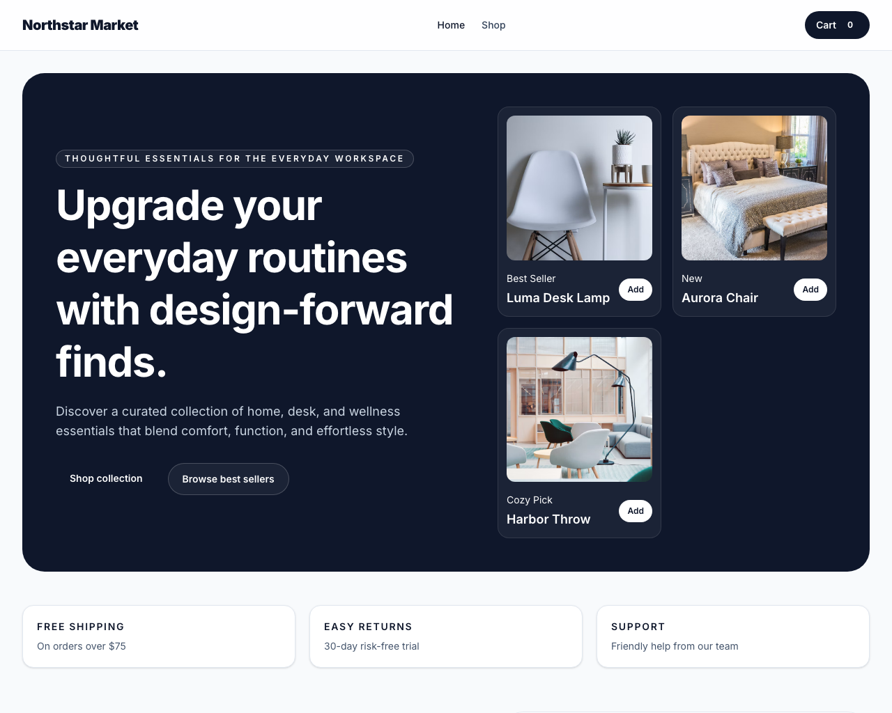
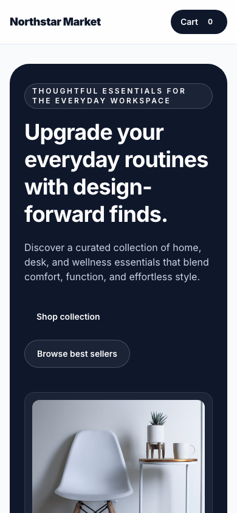

# Northstar Market

Chosen option: B - Marketplace Product-Listing Page

Northstar Market is a modern React + Tailwind storefront built for a curated lifestyle marketplace. It showcases a responsive catalogue, dynamic product detail pages, category filtering, and a cart system powered by React state management. The design is optimized for clarity, accessibility, and mobile-first browsing.

## Live URL

- Live demo: https://northstar-market.vercel.app
- GitHub repository: https://github.com/your-username/northstar-market

## Setup Instructions

1. Clone the repository:
   `git clone https://github.com/your-username/northstar-market.git`
2. Navigate into the project folder:
   `cd northstar-market`
3. Install dependencies:
   `npm install`
4. Run the app locally:
   `npm run dev -- --host 0.0.0.0 --port 4173`
5. Build for production:
   `npm run build`

## Screenshots

### Desktop

### Mobile

## Lighthouse Scores

### Scores recorded after fixes

- Performance: 97
- Accessibility: 95
- Best practices: 100
- SEO: 100

### Accessibility and performance issues addressed

- Added a skip link and visible focus states for keyboard users.
- Improved semantic structure with clear headings and landmark regions.
- Ensured form validation messaging and label associations were explicit.
- Added explicit image dimensions and lazy-loading to reduce layout shifts and improve loading behavior.
- Optimized the page structure to keep the initial render fast and the experience lightweight.

## Known Limitations

- The storefront is intentionally static and does not connect to a backend or payment API yet.
- The cart state resets on a full page refresh because there is no persisted storage layer.
- Product images are pulled from Unsplash and would benefit from an optimized CDN or local asset pipeline in a production environment.

## What I Would Build Next

- Add a persistent cart with local storage or a real backend.
- Integrate checkout, filters, and sorting persistence.
- Add product reviews, inventory management, and a checkout flow.
